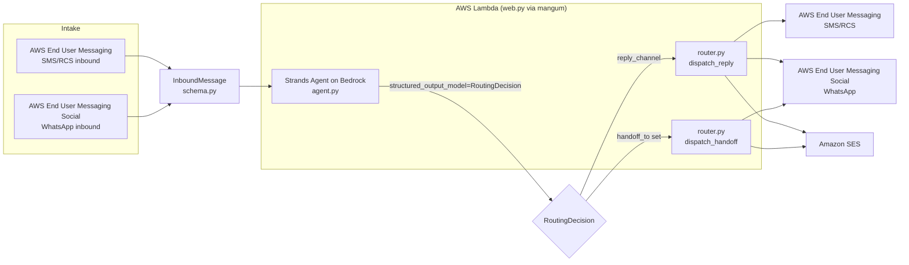

# Omnidamus architecture

Status: describes the code as scaffolded, not a deployed or field-tested system.
No AWS resource in this diagram has actually been provisioned yet (see the main
[README](../README.md) Status section).

## Reference flow

## The cross-channel handoff pattern

The hackathon brief's central ask -- "a conversation starts in one channel and
completes an action in another" -- is implemented as two independent fields on
`RoutingDecision` (`schema.py`), deliberately kept separate from `reply_channel`:

- `reply_channel` / `reply_text`: what to send back right now, on whichever
  channel the current message arrived on (or the channel a prior handoff moved
  the conversation to).
- `handoff_to`: set only when the conversation should move to a *different*
  channel next. `router.dispatch_handoff` sends a short notice on the new
  channel; the next real message the user sends there re-enters the same
  agent loop as a new `InboundMessage` on that channel.

Reference scenario end-to-end:

1. An AWS End User Messaging (SMS/RCS) notification goes out (e.g. "your pickup
   is ready — reply to schedule a time").
2. The user's reply is normalized to an `InboundMessage` on `Channel.SMS_RCS`.
   The agent judges the request needs real back-and-forth and sets
   `handoff_to=Channel.WHATSAPP`.
3. Further exchange happens on WhatsApp as ordinary `InboundMessage`s on
   `Channel.WHATSAPP`.
4. Once the agent sets `conversation_complete=true`, a caller (not yet built --
   see README Status) sends the final written receipt via Amazon SES.

## What is not yet built

- Step 4 above (an explicit "send closing receipt on conversation_complete"
  caller) — `web.py`'s `/inbound/{channel}` endpoint currently dispatches a
  reply and an optional handoff notice, but does not yet act on
  `conversation_complete` itself.
- Conversation state persistence — nothing currently stores which channel a
  conversation is "on" between messages; `conversation_id` exists in the schema
  but nothing reads or writes it yet.
- Provider webhook signature verification for WhatsApp/EUM inbound.
- Rich RCS content (`send_rich_rcs_message` in `channels/sms_rcs.py` is an
  intentional `NotImplementedError` — its payload schema has not been verified
  against AWS documentation yet).
