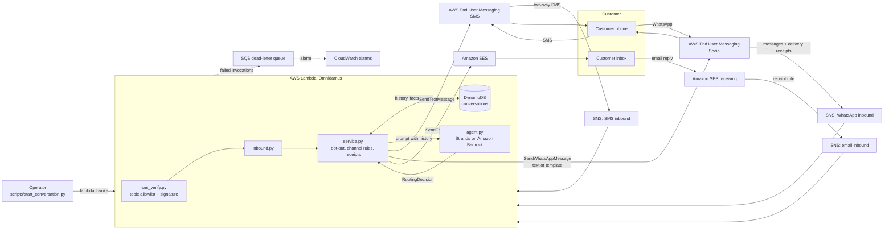

# Omnidamus architecture

Status: describes the code and the SAM template in this repo. The stack has not
been deployed yet and no live message has been exchanged (see the main
[README](../README.md) Status section).

## Flow

## Reference scenario

1. The operator opens a conversation, either with an **SMS/RCS** notification or a
   Meta-approved **WhatsApp template** (the only way a business can start a
   WhatsApp chat).
2. The customer replies. EUM SMS or EUM Social publishes the reply to SNS; the
   function verifies the signature, parses it, and loads the conversation from
   DynamoDB.
3. The agent reads the history and decides where the conversation goes next. A
   move to WhatsApp outside its 24-hour window becomes an approved template, or a
   click-to-chat link on the current channel.
4. When the agent marks the conversation complete, the closing receipt goes out by
   **Amazon SES**, once, to the address on file. Its Reply-To is the SES receiving
   address, so if the customer answers it, the reply comes back through
   **SES receiving** into the same conversation.

## Design choices

- **The model decides, plain code acts.** The agent returns a typed
  `RoutingDecision` (Strands structured output); `service.py` applies the channel
  rules and does the sending. The agent never calls a send API itself.
- **Compliance is not left to the model.** STOP/UNSUBSCRIBE on any channel ends all
  contact before the agent sees the message, and START opts back in. WhatsApp's
  24-hour rule is enforced in code.
- **No public endpoint.** Inbound arrives on SNS and is signature-checked; the
  conversation is opened by a direct Lambda invocation that needs IAM permission.
  `web.py` is local-only.
- **One conversation per customer.** It is keyed by phone number, so moving
  between SMS and WhatsApp keeps the same conversation. Email finds it through a
  pointer from the sender's address. Email from an unknown address never starts a
  conversation.
- **A fresh agent per message.** Strands agents keep their own chat history;
  reusing one would leak conversations into each other. The real history comes
  from DynamoDB.
- **At-least-once tolerant.** SNS redeliveries are dropped by provider message ID;
  concurrent writes to one conversation are caught by a version check and retried.
- **Wiring is scripted, not clicked.** `scripts/connect_inbound.py` sets the event
  destinations through the AWS APIs, dry-run first. It never replaces another SES
  rule set without an explicit flag.

## Not built

- Rich RCS content (`send_rich_rcs_message` is an intentional
  `NotImplementedError`; its payload schema has not been verified against AWS
  documentation).
- Inbound media (images, documents, location) is ignored.
