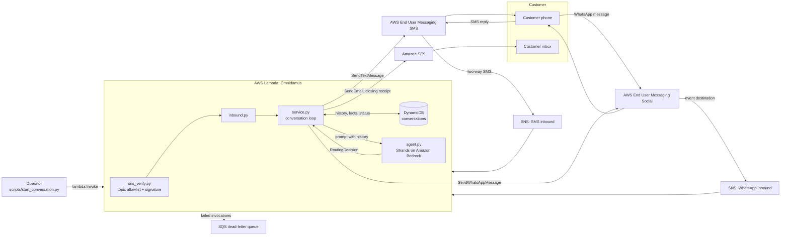

# Omnidamus architecture

Status: describes the code and the SAM template in this repo. The stack has not
been deployed yet and no live message has been exchanged (see the main
[README](../README.md) Status section).

## Flow

## Reference scenario

1. The operator starts a conversation: an **SMS/RCS** notification goes out
   ("your order is ready, reply with a pickup time").
2. The customer replies by SMS. EUM SMS publishes it to the SMS inbound topic, and
   the function verifies, parses and loads the conversation from DynamoDB.
3. The agent decides the exchange needs real back-and-forth and hands off to
   **WhatsApp**. WhatsApp only allows free-text messages within 24 hours of the
   customer's own last WhatsApp message, so the handoff goes out on SMS with a
   click-to-chat link; once the customer messages on WhatsApp, replies flow there.
4. When the agent marks the conversation complete, the closing receipt goes out by
   **Amazon SES**, once, to the address on file (given at the start, or collected
   by the agent during the chat).

## Design choices

- **The model decides, plain code acts.** The agent returns a typed
  `RoutingDecision` (Strands structured output); `service.py` applies the channel
  rules and does the sending. The agent never calls a send API itself.
- **No public endpoint.** Inbound arrives on SNS; the conversation is opened by a
  direct Lambda invocation that needs IAM permission. `web.py` is local-only.
- **One conversation per phone number,** so a customer who moves from SMS to
  WhatsApp stays in the same conversation.
- **A fresh agent per message.** Strands agents keep their own chat history;
  reusing one would leak conversations into each other. The real history comes
  from DynamoDB.
- **At-least-once tolerant.** SNS redeliveries are dropped by provider message ID;
  concurrent writes to one conversation are caught by a version check and retried.

## Not built

- Rich RCS content (`send_rich_rcs_message` is an intentional
  `NotImplementedError`; its payload schema has not been verified against AWS
  documentation).
- Inbound media (images, documents, location) is ignored.
